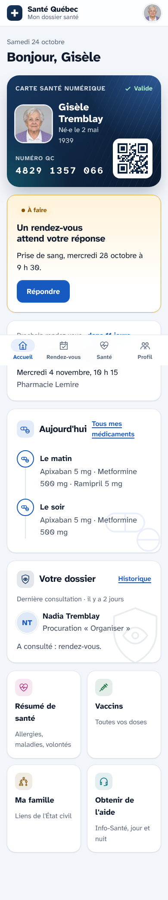
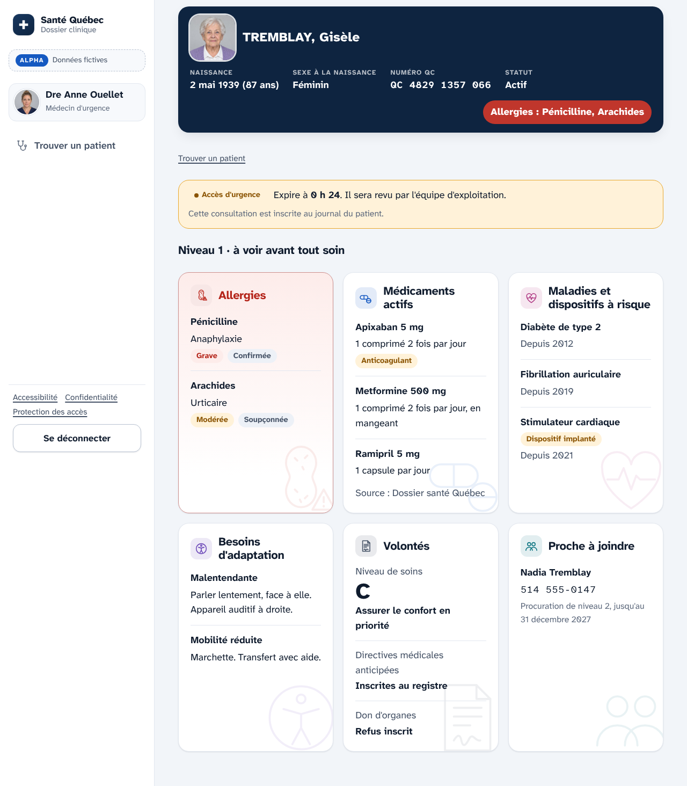

# Santé Québec 2028

Le dossier de santé public du Québec, de la naissance à la fin de vie : un identifiant QC unique, un registre des personnes, une passerelle qui décide qui voit quoi, et un journal des accès que personne ne peut modifier.

**Phase : Alpha.** Toutes les personnes et toutes les données sont fictives. Prototype de conception, non officiel.

| Citoyen, sur téléphone | Espace clinique |
|---|---|
|  |  |

Toutes les captures se trouvent dans [`docs/captures`](docs/captures) et se régénèrent avec `npm run captures`.

Les portraits sont générés par IA : ces personnes n'existent pas. Les prompts sont dans [`docs/photos/prompts.md`](docs/photos/prompts.md) et les images dans `apps/api/db/photos`.

## Ce que fait la version 0.2

**Pour les citoyens et leurs proches**
- Carte santé numérique : photo d'identification, numéro QC et code QR généré localement.
- Tableau de bord : ce qu'il y a à faire, le prochain rendez-vous, les médicaments du jour et la dernière consultation du dossier.
- Profil : photo et date de la prochaine, coordonnées, personnes de confiance.
- Connexion avec le numéro QC. Une faute de frappe est détectée avant tout envoi.
- Rendez-vous : confirmer, ou choisir une autre plage parmi celles qui sont offertes.
- Médicaments regroupés selon le moment de la journée, carnet de vaccination.
- Résumé de santé : allergies, maladies, besoins d'adaptation, volontés.
- « Qui a consulté mon dossier », avec un bouton pour signaler un accès qu'on ne reconnaît pas.
- La famille calculée à partir de l'État civil.
- Les personnes dont on s'occupe : on voit ce que la procuration permet, et pourquoi le reste demeure privé.

**Pour le personnel clinique**
- Recherche par numéro QC ou par NAM.
- Bandeau patient fixe.
- Fiche de niveau 1.
- Accès d'urgence par motif normalisé, limité à 12 heures, puis revu.

**Garanties**
- Règles d'accès centralisées et testées ([0001](docs/decisions/0001-passerelle.md)).
- Journal chaîné que la base refuse de modifier ([0002](docs/decisions/0002-journal.md)).
- « Aucune allergie connue » n'existe que si un professionnel l'a constaté et signé.
- Accessibilité vérifiée automatiquement à chaque modification, selon le SGQRI 008 3.0 (WCAG 2.1 AA, et des critères des WCAG 2.2).
- Police Atkinson Hyperlegible Next (Braille Institute), hébergée avec l'application : aucune requête vers un tiers.
- La photo d'une personne passe par la passerelle et s'inscrit au journal, comme toute donnée d'identité.

## Structure

```
packages/noyau   Règles pures : numéro QC, cycle de vie du registre, accès, journal, parenté.
apps/api         Fastify + PostgreSQL (PGlite en développement). Passerelle, journal, registre.
apps/web         React. Gabarit de service public, espace citoyen, espace clinique.
e2e              Parcours Playwright et vérifications d'accessibilité (axe).
docs             Revue critique, décisions d'architecture, captures.
```

## Démarrer

Il faut Node 22 ou plus récent.

```bash
npm install
npm run seed      # base de développement locale, données fictives
npm run dev       # API sur :3100, application sur http://localhost:5173
```

En développement, aucun texto n'est envoyé : le code s'affiche à l'écran.

| Personnage | Pour se connecter |
|---|---|
| Gisèle Tremblay, 87 ans, mode simplifié, allergie grave | `4829 1357 066` |
| Nadia Tremblay, sa fille, procuration « Organiser » | `3061 8429 756` |
| Sarah Lavoie, enceinte, « aucune allergie connue » vérifiée | `5196 4037 286` |
| Kevin N'Diaye, allergies jamais documentées | `8152 7304 965` |
| Marc Tremblay, père de Léo (15 ans) | `6604 9172 384` |
| Dre Anne Ouellet, urgence, sans lien de soins | `aouellet` |
| Dr Pierre Roy, médecin de famille de Gisèle | `proy` |

## Vérifier

```bash
npm run verifier-types   # TypeScript strict
npm test                 # 18 tests du noyau, 24 tests de l'API par HTTP
npm run e2e              # 20 parcours dans un navigateur, téléphone et ordinateur, avec axe
```

L'intégration continue sur GitHub lance tout cela à chaque push.

## Documentation

- [Revue critique de la version 0.2](docs/revue-critique.md) : ce qui n'allait pas, ce qui a été corrigé, ce qui reste à faire.
- Décisions d'architecture : [passerelle](docs/decisions/0001-passerelle.md), [journal](docs/decisions/0002-journal.md), [authentification avec le SQIN](docs/decisions/0003-authentification.md), [alignement FHIR](docs/decisions/0004-fhir.md).

Le premier prototype, entièrement en mémoire, se trouve au commit `f415155`.
